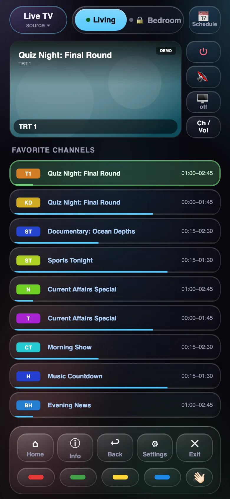
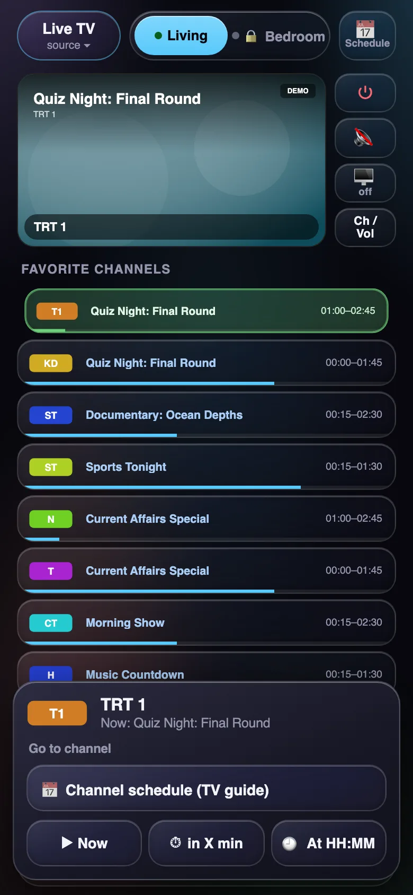
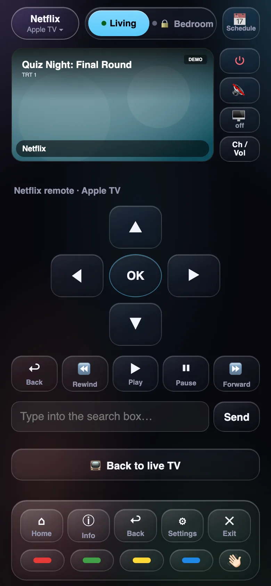
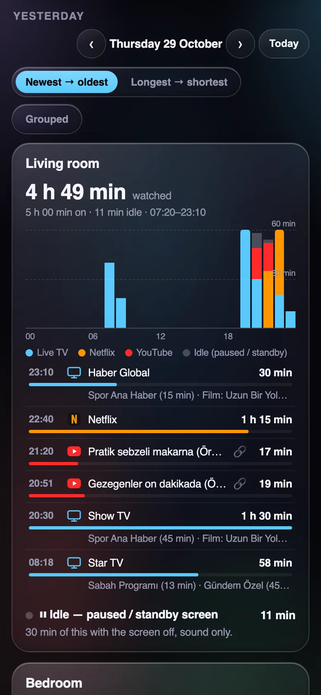
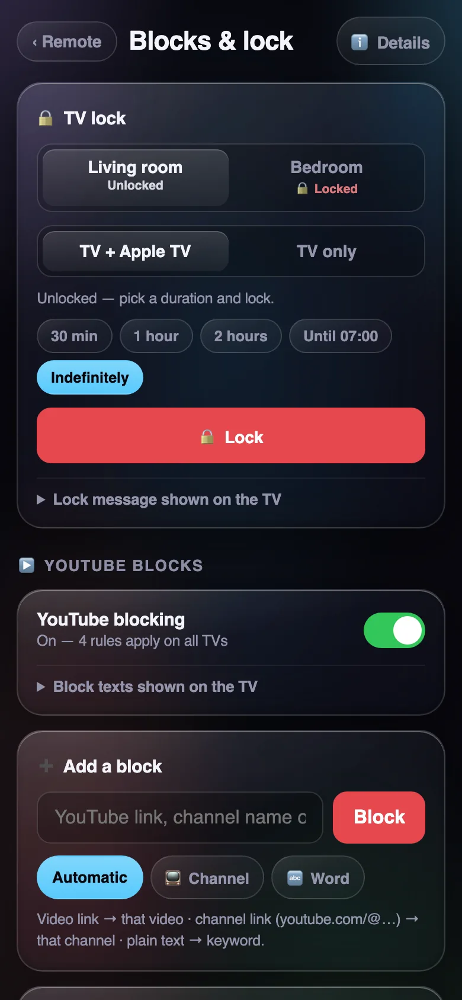

# LG Remote Controller


A phone web remote for **LG webOS TVs** and the **Apple TV** plugged into them, with built-in parental controls.
Add it to your iPhone/Android home screen and it behaves like an app. Tap a channel and the TV turns on and tunes
in. You can also set "back after the ad break", schedule a show, see what was watched today, block YouTube channels
on the Apple TV, or lock a TV so its own remote can't turn it on.

[Türkçe README](README.tr.md)

<p align="center">
  
  
  
</p>
<p align="center">
  
  
</p>

## Try it in 30 seconds (no TV needed)

```bash
git clone https://github.com/niedy707/lg-remote-controller && cd lg-remote-controller
npm install && npm run demo      # → http://127.0.0.1:3061  (fake TVs, nothing leaves your machine)
```

Open it in your browser's phone view, or run `HOST=0.0.0.0 npm run demo` and open it on your phone. Everything in
the demo is invented: TVs, programmes, videos and viewing history.

## What it does

**Remote**
- **Live preview** of the TV screen (the TV takes the screenshot itself)
- **Favorite channels** with the current programme, time range and progress bar; a logo grid for other channels
- **Tap a channel → it opens, even if the TV is off** (Wake-on-LAN, then waits until the TV is ready and checks the channel is really on)
- **Long-press a channel** → go now · in N minutes · at HH:MM · open its programme guide
- **"Back after the ad break"** timer (minute wheel + quick chips) with on-screen warnings 1 min and 10 s before
- **Programme guide** for favorites; "open when it starts" scheduling, one-off or weekly tasks
- **Scheduled on-screen messages** ("dinner in 10 minutes"), optionally turning the TV off afterwards. They are
  created through the agent API (`POST /zamanlayici`) and listed in the Schedule window
- **Source menu**: Live TV · Apple TV · Netflix · Prime Video · Disney+. When an Apple TV is paired, apps open
  **on the Apple TV** (faster than the TV's own apps); otherwise they open on the TV
- **App remote** (D-pad, OK, back, play/pause, ±) that talks to the Apple TV directly, plus "type into the search box"
- **Ch / Vol pad** with a volume strip: drag up to turn it up, drag down to turn it down (where you touch doesn't matter)
- **Settings pad**: touchpad that moves the Magic Remote pointer, D-pad, Back, Exit
- **Screen off, sound on**; on-screen messages; phone notifications when a scheduled programme starts or the ad break ends

**Details (viewing history, optional)**
- Per TV: what is on **now**, and for each day an **hourly chart from 00:00 to 23:59**, like Screen Time.
  Paused or idle time shows in grey and doesn't count as watched
- Day list (newest first or longest first, optionally grouped): live channel + programme, YouTube video
  (with a 🔗 link), Netflix and other Apple TV apps
- Day / week / month history

**Parental controls**
- **TV lock**: timed or until you unlock it. A locked TV ignores the remote and the scheduler, and if someone turns it
  on with its own remote, it shows a message in the middle of the screen and turns off again within seconds.
  Choose "TV only" or "TV + Apple TV" (the Apple TV is put to sleep too, so it can't wake the TV over HDMI-CEC).
  The message is editable
- **YouTube blocks** on the Apple TV: by video link, channel (link or name) or keyword. Two steps: the first time,
  playback stops and leaves the player; if it is played again within 10 minutes, the YouTube app is closed and a
  warning appears. Both on-screen texts are editable
- **Activity log**: every lock/unlock, rule change and blocked attempt, with whether it came from the remote or the API

**Safety**: confirmation before switching an off TV on at night (22:00–07:00) and before every power-off.
Turkish and English interface.

## How it fits together

```
phone ──HTTPS──► server/ (gateway, optional) ──VPN / LAN + token──► agent/ (home network) ──wss:3001──► LG TV
                  login, brute-force lock,                          always-on box, e.g. Raspberry Pi      └─ Companion/MRP ──► Apple TV
                  web push, input validation                         never exposed to the internet
```

- **agent/** runs on an always-on machine in your home network. It holds the TV connections, wakes TVs,
  reads the programme guide, runs the scheduler, the lock and the YouTube block watchers, keeps the viewing history
  and (optionally) controls an Apple TV through [pyatv](https://github.com/postlund/pyatv).
  It only accepts a fixed set of actions; there is no raw SSAP passthrough.
- **server/** is the gateway the phone talks to. Run it at home for LAN-only use, or on a server behind HTTPS
  (nginx) and reach the agent over a VPN such as Tailscale or WireGuard.
- **web/** is the remote itself (vanilla JS, no build step).

## Requirements

- Node.js 20+ on the agent machine and the gateway
- LG webOS TV with network control enabled ("LG Connect Apps" / "Mobile TV On"; the name varies by model) and,
  for power-on, Wake-on-LAN / "Turn on via Wi-Fi"
- Optional: Apple TV + Python 3 with `pyatv==0.18.0` (Companion pairing). Needed for the app remote, YouTube blocks
  and seeing what plays on the Apple TV
- Optional: `python3-pil` on the agent machine, to recognise playback in apps that report nothing (screen motion)

Tested on LG OLED G5 (webOS 25/26), LG SM8000 (webOS 4.5) and Apple TV 4K (3rd gen, tvOS 26–27).

## Setup

### 1. Agent (home network)

```bash
git clone https://github.com/niedy707/lg-remote-controller && cd lg-remote-controller
node agent/eslestir.mjs 192.168.1.50          # accept the prompt on the TV; writes .lgtv-clients.json
cp agent/tvler.example.json tv-ajan.tvler.json # list your TVs (ip, mac for Wake-on-LAN)
sudo ./agent/kur.sh                            # installs /opt/tv-ajan + systemd service, generates the token
```

The token lives in `/etc/tv-ajan.env` (readable by root only); the gateway needs the same value.
Pairing uses the encrypted `wss://…:3001` connection. Only very old models without it need `--duz-ws`
(plain `ws://…:3000`, the pairing key travels unencrypted).

**Apple TV (optional):**

```bash
sudo python3 -m venv /opt/pyatv && sudo /opt/pyatv/bin/pip install pyatv==0.18.0   # needs python3-dev
sudo /opt/pyatv/bin/atvremote --storage-filename /var/lib/tv-ajan/pyatv.conf \
     -s <apple-tv-ip> --id <identifier> --protocol companion pair             # PIN appears on the TV
sudo chown tvajan:tvajan /var/lib/tv-ajan/pyatv.conf && sudo chmod 600 /var/lib/tv-ajan/pyatv.conf
```

Then add `"appletv": { "ip": "…", "id": "…" }` to that TV in `tv-ajan.tvler.json`. If the Apple TV is not on the
TV's default HDMI input, add `"giris": "com.webos.app.hdmi2"` (the TV's app id for that input) inside `appletv`.

Agent environment (`/etc/tv-ajan.env`; `kur.sh` writes a template):

| Variable | |
|---|---|
| `TV_AJAN_TOKEN` | required, ≥ 32 characters (the gateway uses the same value) |
| `TV_AJAN_HOST`, `TV_AJAN_PORT` | listen address (default `127.0.0.1`; use the VPN/LAN address if the gateway runs elsewhere) and port (default `3027`) |
| `TV_AJAN_TZ` | local time zone, IANA name (default `Europe/Istanbul`): scheduler times, days of the viewing history |
| `TV_AJAN_IZLEME=1` | turn on the viewing history (Details page). Off by default: it is personal data and stays in the agent's state directory |
| `TV_AJAN_PYATV` | Python with pyatv (default `/opt/pyatv/bin/python3`; without it the Apple TV features are off) |
| `TV_AJAN_PYTHON` | Python with PIL for screen-motion detection (default `/usr/bin/python3`) |
| `TV_AJAN_BILGISIZ_UYGULAMA` | label for Apple TV playback that reports no app or title (default `Apple TV`) |
| `TV_AJAN_DUZ_WS=1` | allow falling back to plain `ws://…:3000` (old models only; not encrypted) |
| `TV_AJAN_TVLER`, `TV_AJAN_ANAHTARLAR`, `TV_AJAN_DURUM` | paths of the TV list, the pairing keys and the state directory |

### 2. Gateway

```bash
npm install --omit=dev
cp config.example.json config.json   # favorite / other channels, logo file names
mkdir -p data/logolar                # put channel logos here (<name>.png). Not shipped: they are broadcasters' trademarks
```

Environment:

| Variable | |
|---|---|
| `TV_AJAN_URL`, `TV_AJAN_TOKEN` | agent address (e.g. `http://100.x.y.z:3027`) and token |
| `KUMANDA_PASSWORD` | long-lived password (the device stays signed in while it is used). Use at least 10 characters if the gateway is on the internet |
| `KUMANDA_SESSION_PASSWORD` | optional guest password: the sign-in ends when the browser closes (at most 12 h) |
| `KUMANDA_SESSION_SECRET` | cookie signing key, ≥ 32 characters, keep it fixed (`openssl rand -hex 32`) |
| `KUMANDA_OTURUM_NESLI` | optional counter: change it to sign every device out |
| `KUMANDA_TZ` | time zone of the interface (default `Europe/Istanbul`); keep it equal to the agent's `TV_AJAN_TZ` |
| `KUMANDA_PROXY=1` | behind nginx (client IP from `X-Real-IP`) |
| `KUMANDA_COOKIE_SECURE=false` | only when testing without HTTPS |
| `KUMANDA_VERI`, `KUMANDA_AYAR` | data directory (push subscriptions, logos; default `data/`) and config file (default `config.json`) |
| `VAPID_PUBLIC_KEY`, `VAPID_PRIVATE_KEY`, `VAPID_SUBJECT` | optional web push (`npx web-push generate-vapid-keys`) |
| `PORT`, `HOST` | default `3060`, `127.0.0.1` |

```bash
npm run server
```

`deploy/` has a systemd unit and an nginx example. On iPhone, notifications work only when the remote is added to
the home screen (iOS 16.4+).

## Limits worth knowing

- **What plays on the Apple TV** comes from the Apple TV itself. YouTube reports title and channel; Netflix and many
  other apps report only that they are playing or paused, not what. Apps that report nothing are recognised by
  screen motion and logged under the `TV_AJAN_BILGISIZ_UYGULAMA` label.
- **YouTube blocks** work on the Apple TV's YouTube app, not on the TV's own YouTube app. They are a speed bump for
  children, not a security boundary.
- **Channel ordering** (the channel list editor in the agent) works on satellite (DVB-S) lists only.
- **Programme guide**: the current/next programme comes from Turkish guide sources (digiturk, tvplus) fetched by the
  agent. Outside Turkey the guide is simply empty; everything else works.

## Security notes

- The agent never listens on the internet; bind it to a VPN or loopback address.
- Login: HMAC-signed stateless cookie bound to the password, so changing the password signs everyone out.
  5 wrong attempts per IP → 1 hour lock; 20 per hour from all addresses → new sign-ins closed for 1 hour;
  60 in 24 hours → closed for 24 hours. Signed-in devices are not affected. A notification goes out every 10 failures.
  Cross-site POSTs are rejected, and push endpoints are limited to real browser push services.
- A guest password is not single-use: it works until you change it, and a guest can do everything the owner can.
  Sign guests in on their phone yourself rather than sharing the password around.
- Every action is validated twice (gateway and agent); the agent has no raw protocol passthrough.
- The viewing history, block rules and lock log are personal data. They stay in the agent's state directory and
  are never sent anywhere else.

## Tests

```bash
npm test
```

## License

MIT
