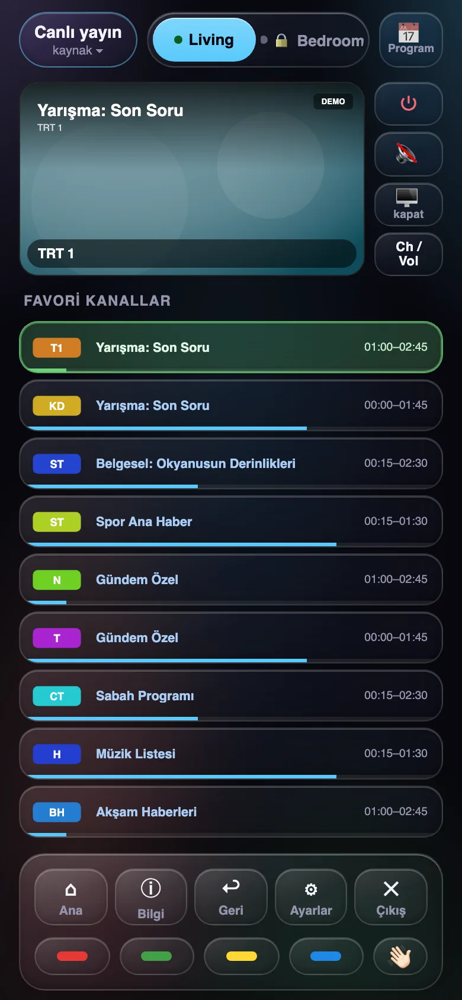
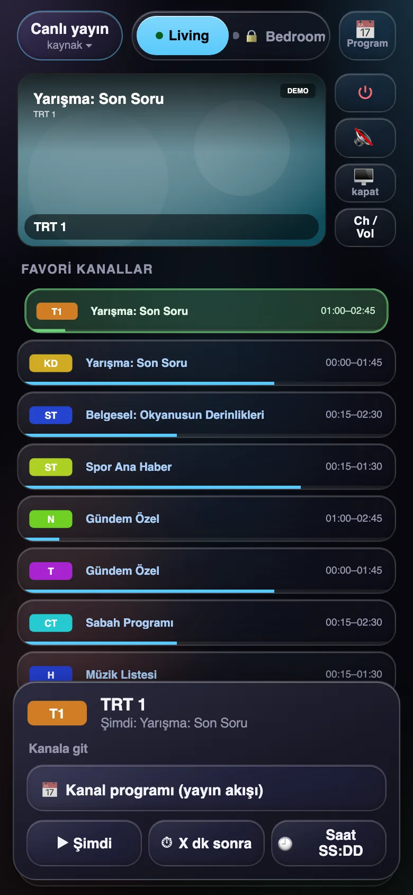
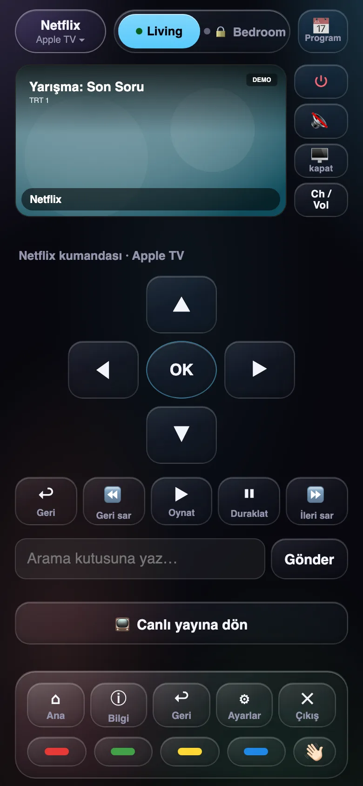
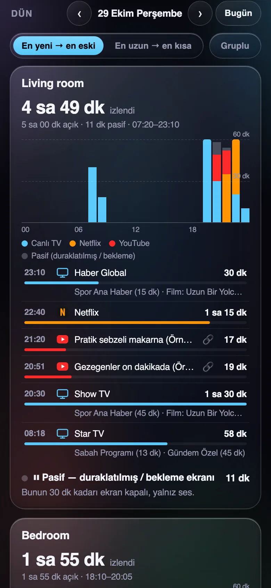
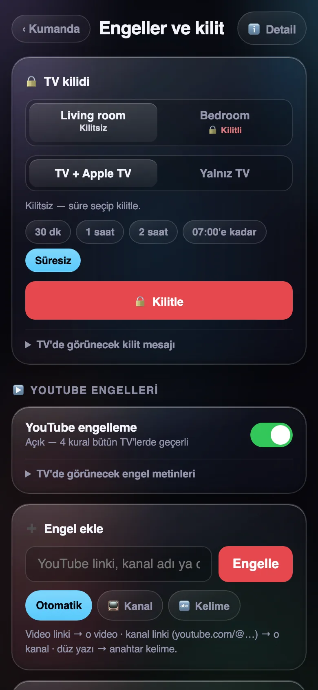

# LG Remote Controller

**LG webOS TV'ler** ve onlara bağlı **Apple TV** için ebeveyn denetimli telefon web kumandası. iPhone/Android ana
ekranına eklenince uygulama gibi açılır. Kanala dokunursun, TV açılır ve o kanala geçer. "Reklamdan sonra geri
dön" kurabilir, program zamanlayabilir, bugün ne izlendiğini görebilir, Apple TV'de YouTube kanallarını
engelleyebilir ya da TV'yi kendi kumandasıyla açılamayacak şekilde kilitleyebilirsin.

[English README](README.md)

<p align="center">
  
  
  
</p>
<p align="center">
  
  
</p>

## 30 saniyede dene (TV gerekmez)

```bash
git clone https://github.com/niedy707/lg-remote-controller && cd lg-remote-controller
npm install && npm run demo      # → http://127.0.0.1:3061  (sahte TV'ler, hiçbir şey makineden çıkmaz)
```

Demodaki her şey uydurmadır: TV'ler, programlar, videolar, izleme geçmişi.

## Neler yapar

**Kumanda**
- TV ekranının **canlı önizlemesi** (görüntüyü TV kendisi verir)
- **Favori kanallar**: şu anki program, saat aralığı, ilerleme çubuğu; diğer kanallar için logo ızgarası
- **Kanala dokun → TV kapalı olsa bile açılır** (Wake-on-LAN, TV hazır olana kadar bekler, kanalın gerçekten açıldığını doğrular)
- **Kanala basılı tut** → şimdi · X dk sonra · saat SS:DD'de git · o kanalın yayın akışı
- **"Reklamdan sonra geri dön"** sayacı (dakika tekerleği + hızlı seçim); 1 dk ve 10 sn kala TV ekranında uyarı
- **Yayın akışı**, "başlayınca aç", tek seferlik ya da haftalık program
- **Zamanlı TV mesajı** ("yemeğe 10 dakika"), istenirse ardından TV kapanır. Ajan API'siyle kurulur
  (`POST /zamanlayici`), Program penceresinde listelenir
- **Kaynak menüsü**: Canlı yayın · Apple TV · Netflix · Prime Video · Disney+. Apple TV eşleşmişse uygulamalar
  **Apple TV'de** açılır (TV'nin kendi uygulamasından hızlı), değilse TV'de
- **Uygulama kumandası** (yön tuşları, OK, geri, oynat/duraklat, ±) Apple TV'ye doğrudan gider; arama kutusuna yazı
- **Ch / Vol** penceresinde ses şeridi: yukarı kaydırınca ses artar, aşağı kaydırınca azalır (dokunulan nokta önemli değil)
- **Ayarlar penceresi**: Magic Remote imlecini oynatan dokunmatik yüzey, yön tuşları, Geri, Exit
- **Ekranı kapat, ses açık**; TV ekranına mesaj; planlı yayın başlayınca ya da reklam bitince telefona bildirim

**Detail (izleme geçmişi, isteğe bağlı)**
- TV başına **şu an** ne açık; her gün için iPhone Ekran Süresi gibi **00:00–23:59 saatlik grafik**.
  Duraklatılmış ya da beklemedeki süre gri görünür, izlenmiş sayılmaz
- Gün listesi (en yeni ya da en uzun önce, isteğe bağlı gruplu): canlı kanal + program, YouTube videosu
  (🔗 bağlantısıyla), Netflix ve diğer Apple TV uygulamaları
- Gün / hafta / ay geçmişi

**Ebeveyn denetimi**
- **TV kilidi**: süreli ya da sen açana kadar. Kilitli TV kumandayı ve zamanlayıcıyı dinlemez. Biri TV'yi kendi
  kumandasıyla açarsa ekranın ortasında mesaj çıkar ve birkaç saniye içinde yeniden kapanır. "Yalnız TV" ya da
  "TV + Apple TV" seçilir; ikincisinde Apple TV de uyutulur, HDMI-CEC ile TV'yi yeniden açamaz. Mesaj değiştirilebilir
- **YouTube engelleri** (Apple TV'de): video linki, kanal (link ya da ad) ya da anahtar kelime. İki kademe: ilk seferde
  oynatma durur ve oynatıcıdan çıkılır; 10 dakika içinde yeniden oynatılırsa YouTube uygulaması kapatılır ve uyarı
  çıkar. Ekrandaki iki metin de değiştirilebilir
- **İşlem kaydı**: her kilitleme/açma, kural değişikliği ve engellenen deneme; kumandadan mı API'den mi geldiğiyle

**Güvenlik**: gece (22:00–07:00) kapalı TV'yi açan her komutta ve her kapatmada onay. Türkçe ve İngilizce arayüz.

## Yapı

```
telefon ──HTTPS──► server/ (geçit, isteğe bağlı) ──VPN / yerel ağ + belirteç──► agent/ (ev ağı) ──wss:3001──► LG TV
                    giriş, kaba kuvvet kilidi,                                   7/24 açık küçük bilgisayar    └─ Companion/MRP ──► Apple TV
                    web push, girdi denetimi                                     internete hiç açılmaz
```

Kurulum adımları ve ortam değişkenleri için [README.md](README.md) (komutlar aynı).

## Bilinmesi gereken sınırlar

- **Apple TV'de ne oynadığı** Apple TV'nin kendisinden okunur. YouTube başlık ve kanal verir; Netflix ve birçok
  uygulama yalnız oynuyor/duraklatıldı bilgisi verir, ne oynadığını vermez. Hiç bilgi vermeyen uygulamalar ekran
  hareketinden tanınır ve `TV_AJAN_BILGISIZ_UYGULAMA` etiketiyle kaydedilir.
- **YouTube engelleri** Apple TV'deki YouTube uygulamasında çalışır, TV'nin kendi YouTube uygulamasında değil.
  Çocuklar için bir yavaşlatıcıdır, güvenlik sınırı değildir.
- **Kanal sıralama** (ajandaki kanal listesi düzenleyici) yalnız uydu (DVB-S) listesinde çalışır.
- **Yayın akışı**: "şu an / sonra ne var" bilgisi Türkiye'deki rehber kaynaklarından (digiturk, tvplus) ajan
  tarafından çekilir. TV'nin kendi akışı güvenilmez çıktı (başka kanalın ertesi gününü veriyordu). Türkiye dışında
  akış boş kalır, geri kalan her şey çalışır.

## Güvenlik notları

- Ajan internete hiç açılmaz; VPN ya da loopback adresine bağlanır.
- Giriş: şifreye bağlı, HMAC imzalı durumsuz çerez; şifre değişince herkes çıkar. IP başına 5 hatalı deneme → 1 saat
  kilit; tüm adreslerden saatte 20 → yeni girişler 1 saat kapalı; 24 saatte 60 → 24 saat kapalı. Girişli cihazlar
  etkilenmez; her 10 hatada bildirim gider. Başka siteden gelen POST reddedilir, bildirim adresleri yalnız gerçek
  tarayıcı push servisleri olabilir. İnternete açık kurulumda şifre en az 10 karakter olmalı.
- Misafir şifresi tek kullanımlık değildir: değiştirilene kadar çalışır ve misafir sahibinin yapabildiği her şeyi
  yapabilir. Şifreyi dolaştırmak yerine misafirin telefonunda girişi sen yap.
- Her işlem iki kez doğrulanır (geçit ve ajan); ajanda ham protokol geçişi yoktur.
- İzleme geçmişi, engel kuralları ve kilit kaydı kişisel veridir. Ajanın durum dizininde kalır, başka hiçbir yere
  gönderilmez.

## Ön tarama (18.10.2026)

Kod yazılmadan önce benzer açık projelere bakıldı (17.10.2026 taraması; her proje GitHub API'den künyesiyle
ve kaynak koduyla açılıp doğrulandı):

| Proje | Ne | Lisans | Bizim için |
|---|---|---|---|
| home-assistant/core `webostv` + `aiowebostv` | Home Assistant entegrasyonu ve SSAP kütüphanesi | Apache-2.0 | Durum aboneliği, kanal eşleme sırası (tam ad → numara → kısmi), ekran kapatma ucu fikirleri |
| klattimer/LGWebOSRemote | Python CLI (~60 komut) | MIT | Uç listesi doğrulaması; telefon arayüzü yok |
| chros73/bscpylgtv | Python kütüphane + CLI | MIT | İmzasız istemci bildirimi (webOS 25+ eşleşmesi) burada belgelenmiş |
| hobbyquaker/lgtv2 | Node kütüphanesi | MIT | Kumanda soketi protokolü; bağımlılık olarak alınmadı (kendi küçük istemcimiz) |
| merdok/homebridge-webos-tv | Homebridge eklentisi | MIT | Apple Home içinden kanal düğmeleri, kapalıyken basınca önce açar; zamanlayıcı yok (HomeKit otomasyonlarına bırakılmış) |
| madmicio/LG-WebOS-Remote-Control | HA Lovelace kumanda kartı | belirtilmemiş | Arayüz olarak en yakını; lisansı olmadığı için yalnız fikir alındı |
| postlund/pyatv | Apple TV protokol kütüphanesi | MIT | Apple TV'de uygulama açma, tuşlar ve "şu an oynayan" için kullanılıyor (ayrı süreç) |

**Karar:** taranan projelerin hiçbirinde proje içi zamanlayıcı ("reklamdan sonra geri dön", "başlayınca aç"),
dış rehberden yayın akışı ve Apple TV yönetimi birlikte yok; ekran görüntüsünü yalnız bscpylgtv alıyor.
Yeni proje olarak yazıldı. LG protokol istemcisi bağımlılıksız kendi kodumuz; Apple TV için pyatv ayrı bir
yardımcı süreçte kullanılıyor.

## Lisans

MIT
